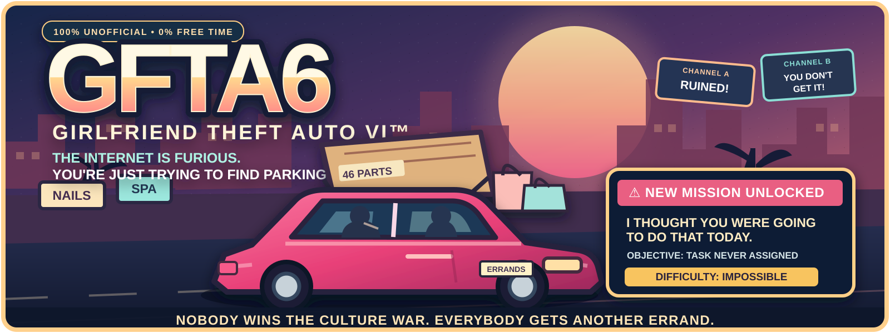

# GFTA6 — GIRLFRIEND THEFT AUTO VI™

> **The Internet Is Furious. You're Just Trying to Find Parking.**

**Nobody wins the culture war. Everybody gets another errand.**

GFTA6 is an **apolitical, open-world domestic comedy** about the most dangerous missions ever devised: finding a parking space, collecting the correct groceries, assembling flat-pack furniture, and hearing the words *"While you're out, can you just…"*

Your girlfriend controls the mission queue. You control the car. Neither of you controls the traffic.

Built as an original, offline-first browser game with **VANILLAJS**, HTML5, CSS3, and JavaScript. **Apache-2.0**.

## At a glance

| | |
|---|---|
| **Genre** | Open-world domestic comedy / errand simulator |
| **Engine** | [VANILLAJS](https://github.com/QSOLKCB/VANILLAJS) |
| **Platform** | Modern web browsers; offline-first target |
| **Tech** | HTML5, CSS3, vanilla JavaScript |
| **Dependencies** | Minimal by design |
| **Licence** | Apache License 2.0 |
| **Political alignment** | None. Fucks Given = 0. |
| **Targets of satire** | Everyone else. Left, Right, Up & Down. |
| **Development status** | v0.2.0 release candidate — original 2D/2.5D Suburbania, full Saturday and air-combat arcade |

## The comedy philosophy

GFTA6 does **not** take a political side. It takes the piss out of the internet's endless need to pick one.

The satire targets outrage, overconfidence, reaction videos, performative arguments, and the bizarre expectation that every video game must be a political referendum. Nobody gets a heroic speech. Nobody wins the argument. The player still has to pick up the dry cleaning.

An optional **fictional in-game outrage feed** might read:

> **OUTRAGE CHANNEL A:** "This game is destroying civilisation!"  
> **OUTRAGE CHANNEL B:** "People complaining about this game are destroying civilisation!"  
> **THE PLAYER:** "Can someone tell me where the bloody dry cleaners are?"

Both camps are caricatures of online behaviour, not statements about everyone who holds a given view. **The game is about domestic absurdity; the internet argument is background noise.**

### Official mission statement

**Politics is stupid. Parking is worse.**

## The premise

You have a car, a house, a bank balance, and what appears to be a free Saturday.

You do not have a free Saturday.

Your girlfriend needs a lift to the salon. Then the health spa. Then the shops. Then she remembers a parcel. Then the dog needs something. Then the furniture arrives. Then she asks why you haven't cleaned the kitchen.

There is no wanted level. There is a **"You Forgot Something" level**.

### Prologue: "I'LL ONLY BE FIVE MINUTES."

**Estimated completion time:** 4 hours, 37 minutes.

Drive to the nail salon. Find parking. Wait five minutes. Wait another five. Discover your parking ticket has expired. Get a message:

> "Actually, can you grab a few things while you're there?"

**MISSION UPDATED.**

### The "While You're Out" Engine™

Every time you get close to home, your phone buzzes with another *tiny* request. The engine tracks your current route, remaining fuel, cargo space, and how close you were to finally putting your feet up. The closer you get to the driveway, the greater the temptation for the game to invent one more stop.

The perfect Saturday, according to the game:

| Time | Event |
|---|---|
| **9:00 AM** | "Babe, can you do one little thing?" |
| **9:15 AM** | Mission accepted. |
| **11:30 AM** | You've visited Bunnings, three supermarkets, and a furniture warehouse. |
| **1:45 PM** | "Oh, I forgot to tell you something." |
| **3:00 PM** | **NEW OBJECTIVE:** Return to Bunnings. |
| **5:30 PM** | "You haven't done anything with me today!" |
| **6:00 PM** | **MISSION FAILED:** You were supposed to know. |

But even reaching your front door doesn't end the quest:

```text
╔══════════════════════════════════════════════════╗
║               NEW MISSION UNLOCKED               ║
╠══════════════════════════════════════════════════╣
║                                                  ║
║ "I THOUGHT YOU WERE GOING TO DO THAT TODAY."      ║
║                                                  ║
║ Objective: Complete a task that was never assigned.║
║                                                  ║
║ Difficulty: IMPOSSIBLE                            ║
╚══════════════════════════════════════════════════╝
```

No quest marker. No briefing. No acknowledgement that the objective did not exist five seconds ago.

**Design rule:** the unfairness is funny because the mission system is knowingly absurd. The game caricatures impossible expectations, not an entire gender; both characters can misunderstand each other, and everybody gets to be ridiculous.

## GFTA6-POLISH-001 — ONE MORE ERRAND™ (v0.2.0 candidate)

This review-stage release pass keeps the original Saturday, air combat,
street atmosphere, and the excellent F-UH-K idle engine intact.
It adds a dedicated **NPC VOICES ON/OFF** toggle: disable spoken insults
while keeping the subtitles, living traffic, and player's engine.
Both Classic and Raised speech bubbles are clamped to the camera viewport
and drawn as readable overlays above building scenery; the minimap marks
ambient traffic and pedestrians without treating them as physical hazards.

No new collisions, traffic AI, damage model or fines. The vehicles and
pedestrians deliberately remain **ghost traffic**: they're atmosphere,
not obstacles or targets. Static-world driving collision is unchanged.

[Polish design / acceptance checks](docs/GFTA6_POLISH_001.md) ·
[Proposed v0.2.0 release notes](docs/GFTA6_RELEASE_v0.2.0_CANDIDATE.md).

**Release status:** Candidate, awaiting independent Codex review,
manual gameplay/audio acceptance and owner-authorised tag. No tag is
created as part of this PR.

## GFTA6-DRIVING-002 — SUBURBANIA HAS LOST ITS PATIENCE™ (merged PR #20)

**Saturday's streets are now populated.** Six originally authored, moving
traffic cars and six walking pedestrians follow deterministic, bounded
fixed-tick paths derived from the chosen seed. They appear in both
Classic and Raised 2.5D views; the raised cast participates in the
existing building/player painter order. Speech bubbles follow speakers,
and the **STREET RADIO / NO INSIDE VOICES** strip displays every
triggered line.

The traffic has its own **synthetic voices**, distinct from the
player's beloved idling F-UH-K engine (which remains **unchanged**).
The furious cab says "ARSEHOLE... ARSEHOLE?!" and "ASSHOLE...
ASSHOLE..."; a car declares "MY INDICATOR IS A PERSONAL BOUNDARY!";
pedestrians shout "OUTTA MY WAY, DICKHEAD!", "I'M WALKIN' 'ERE!"
and "FUGGEDABOUTIT!" Other drivers yell about their dashcam podcasts,
the horn, roundabouts and personally owning lanes. Pedestrians offer
views on footpaths, scooters, and the car's divorce-court vocabulary.
There are **14 authored dialogue lines** in all.

Both drivers and pedestrians get **distinct offline PCM voices** generated
by an original deterministic, bounded pseudo-speech oscillator. Audio
is deliberately robotic and subtitle-guided, **not human-quality
text-to-speech**; no voice assets, Web Speech API, external TTS service,
npm libraries or CDN are required. It plays only near the player and
only on fixed simulation-tick cue slots. Existing **SFX ON/OFF** also
mutes street speech; pause, blur, other game modes and endings silence it.

Street NPCs are intentionally **visual/audio actors only** and will remain
non-colliding: no pedestrian impacts, traffic fines, blocked routes or
changes to Saturday's authoritative vehicle/replay rules. This is a
deliberate atmospheric design choice, not unfinished collision mechanics.

[Technical and testing contract](docs/GFTA6_DRIVING_002.md).

## GFTA6-CAR25D-001 — THE ENGINE HAS HAD ENOUGH™ (merged PR #19)

Saturday driving now has an **original extruded 2.5D car** in the **VIEW: RAISED 2.5D**
presentation. Hatchback, coupe and van have separate roof proportions, wheels,
windows, front/rear lamps, height-shaded side panels and deterministic building
occlusion. The **Classic 2D** view and all underlying physics remain unchanged.

The car also gets a wildly frustrated **F-UH-K speech-motor synthesizer**:
48 kHz original PCM is generated **offline, locally and deterministically**
from an integer seed. A four-syllable robotic phoneme loop mixes filtered
unvoiced F hiss, voiced UH, sharp K-like releases and a piston drone. Real
authoritative speed and held throttle set the playback rate and volume, so
the car goes from muttered "fuck..." to increasingly furious mechanical
swearing. This is deliberately **approximate synthetic vocalisation**, not a
sample of a speaker or guaranteed intelligible speech.

The existing **SFX ON/OFF** toggle also mutes the engine; pause, lost focus,
mini-games, ending, air combat and flight silence it. Audio starts only after
the user starts the game; it is not included in deterministic state receipts.
No TTS APIs, downloads, new runtime dependencies, upstream engine changes,
telemetry or third-party assets.

[Technical design and acceptance contract](docs/GFTA6_CAR25D_ENGINE_001.md).

PR #19 is merged. The verified exact-head browser run passed 120 tests;
owner listening impressions confirm that the existing idle muttering is
particularly funny. The audio generator itself is intentionally preserved.

## GFTA6-AIRWAR-001 — THE GROUP CHAT STRIKES BACK™ (merged PR #18)

The optional **ADVANCED AIR WAR** button combines five merged VANILLAJS
engine systems into a distinct, more sophisticated version of the
existing six-wave dogfight. The original HARD Saturday game and the
classic TOO CLOSE FOR GUNS™ arcade remain fully available.

- **CAD-003:** Original bounded Forge fighter, command-plane and static
  world meshes, all rendered from real physical target centres.
- **WORLD-VIS-001:** Conservative camera frustum/LOD selects retained
  original static world triangles under a **320-triangle/frame Canvas2D
  rendering budget**. This is *not* a WebGL GPU retainer.
- **TACTICS-001:** Actual SENSE visibility and deterministic NavigationGrid
  orders reposition enemy tactical formation lanes every 60 game ticks.
  These offsets affect real target centres used by gun and missile tests.
- **TRAJECTORY-001:** New 120 Hz lead-guided interceptor visual/contact
  receipts from the physical swept actor-collision module. They do
  **not** damage a stationary stand-in pilot; original boss hull
  rules retain exclusive damage authority.
- **CREATOR-INTEROP-001:** Original source-validated CAD and scene content,
  **EXPORT AIRWAR WORLD** / **IMPORT AIRWAR WORLD** for offline SHA-256
  sealed JSON with atomic tamper/invalid-scene rejection.

All 12 newly vendored engine/transitive files are **unchanged** from
merged VANILLAJS SHA
`e9121ea7297b0aeca1da131b695e7c3371a98745`.
Exact Git blob identities and licence attribution are checked offline.
No npm dependencies, CDN, telemetry or proprietary art are added.

See [GFTA6-AIRWAR-001: full source and acceptance contract](docs/GFTA6_AIRWAR_001.md).
**PR #18 is merged.** Independent manual frame-time acceptance remains a
separate hardware exercise; no native 60 FPS claim is made here.

## GFTA6-AIRCOMBAT-003 — MISSILE LOCK + GUN HIT PRECISION (merged PR #17)

**TOO CLOSE FOR GUNS™** now requires an actual sustained physical lock
before M can launch. Hold one target within the narrower **9°** boresight
cone for **0.8 seconds** to fill the lock meter; a lock is confirmed
visibly and with an original chime. Swing away, switch targets or
attempt to fire prematurely and the missile will **not** launch or
spend ammunition. The unchanged upstream VANILLAJS physical lock and
projectile checks still apply.

Space gunfire now checks the real muzzle rays against **every** live
aircraft instead of silently testing only the first surviving rival.
Gun impacts show **HIT CONFIRMED / TARGET DISENGAGED**, while misses
show **MISSED — ADJUST AIM** at the reticle. The new in-game lock
status and visible target outlines come from the same authoritative
simulation record. No source-pinned game engine APIs were modified.

Read [AIRCOMBAT-003 precision, difficulty, and review contract](docs/GFTA6_AIRCOMBAT_003.md).
PR #17 is merged; the sustained missile acquisition and real gun-hit feedback are on main.

## GFTA6-AIRCOMBAT-002 — THE FINAL WORD™ (merged PR #16)

**TOO CLOSE FOR GUNS — SWITCHING TO MISSILES!™** now has a six-wave
campaign: the original Derek and Group Chat encounters, followed by
**THE MUTUAL FRIENDS™**, **THE READ RECEIPTS™**, and a formidable final
boss, **THE FINAL WORD™**. There are now **14 unique aircraft contacts**.

The boss has its own **original ADSR/Paula chip-music theme**. It is a large original 2.5D command plane with **12 HP, three
dialogue/attack phases and a telegraphed personal-space interceptor**.
When its warning appears, use **A/D to evade** the indicated attack lane.
Three hits to your hull end the run, but Replay returns to the same
seed and standalone game mode. The existing gun/missile physics,
non-graphic explosions, original soundtrack and difficult Saturday
missions are preserved.

The familiar owner-locked **MISSION ACCOMPLISHED** / **"HE'S ACTUALLY A
REALLY NICE GUY."™** dialogue still plays after the final boss is
defeated; it has not been rewritten.

Read [the expanded squadron contract, boss mechanics and review
gates](docs/GFTA6_AIRCOMBAT_002.md).
PR #16 is merged; the expanded six-wave squadron and final boss are on main. No change to VANILLAJS or its source pins is required.

## GFTA6-AUDIO-001 — Chip soundtrack and impact polish (merged PR #15)

Three original, **offline-generated stereo soundtracks** now accompany
Saturday errands, Freedom Flight, and **TOO CLOSE FOR GUNS™**. All use the
unchanged VANILLAJS four-channel SID-inspired ADSR × Paula-style PCM engine,
pinned to merged commit `a4bfb2c200964061a2a3f06f68883f28f65b63a3`
and checked by exact Git blob hash.

The game now includes original weapon, missile-launch, aircraft-hit,
explosion, UI, and victory sound effects. During dogfights the 2.5D
renderer shows deterministic expanding shock rings, sparks, smoke and
missile trails at **physically projected impact locations**. These are
presentation effects and cannot change weapon damage or combat outcomes.

Sound starts on the player's **Start Saturday / Start Dogfight click**
(never on page load). Separate **MUSIC** and **SFX** toggles are available
in the toolbar. Browser audio is optional and generated locally; no
commercial music files, downloads, cloud service or npm dependencies.

To audition all three original compositions and ten SFX as WAV files:

```sh
node scripts/export-chip-audio.mjs ./audio-previews
```

See the [audio source pins, design and listening acceptance criteria](docs/GFTA6_AUDIO_001.md).
PR #15 is merged. The offline-generated chip soundtrack, SFX and
impact effects are present on the published GFTA6 main branch.

## GFTA6-BROWSER-001 — Real Chromium CI/CD gate (merged PR #14)

A new dependency-free Node 24 acceptance harness starts **real headless
Chromium/Chrome** in GitHub Actions and uses the DevTools Protocol to
exercise actual mouse clicks, keyboard input, Canvas drawing, mobile
layout and a fully **offline service-worker reload**.

The same smoke now gates pull-request CI and production GitHub Pages
publishing: a failed browser assertion blocks the deployment even when
unit tests pass. Screenshots are preserved as uniquely named Actions
artifacts for independent review.

[Executed browser acceptance and local instructions](docs/GFTA6_BROWSER_001.md).
PR #14 is merged. The real-browser gate is active on `main` and in the production Pages workflow.

## GFTA6-MODES-001 — TOO CLOSE FOR GUNS — SWITCHING TO MISSILES!™ (merged PR #13)

You can now enter the **entire JUST A FRIEND SQUADRON™ air-combat arcade**
directly from a **separate start-screen button**, with no need to beat
the (deliberately difficult) Saturday campaign first.

**START SATURDAY** still starts the original story, complete with the
unchanged economy, errands, escape fund, aircraft restoration and hard
flight. The optional ACT IV checkbox still extends that story after a
successful escape. **Nothing has become easier.**

**TOO CLOSE FOR GUNS — SWITCHING TO MISSILES!™** begins wave one of the
existing three-wave encounter immediately, using the same physical cockpit
sights, missile locks, seed-based opponent movement and fixed-tick rules.
Use W/S + A/D to aim, Space for guns, M for missiles, and P to pause.
Replay restarts the selected mode instead of throwing you into the other
campaign. The standalone sidebar tracks actual combat waves, not grocery
errands. The canonical Derek finale is unchanged.

Read [GFTA6-MODES-001 mode separation and review criteria](docs/GFTA6_MODES_001.md).
PR #13 is merged; the separate arcade launch is available on the live Pages game.

## GFTA6-AIRCOMBAT-001A — JUST A FRIEND SQUADRON™ (merged PR #11)

The merged VANILLAJS COCKPIT-002 release now supplies the actual
gun-sight geometry and deterministic missile module. A new **opt-in
ACT IV** checkbox at the start of Saturday extends the existing
Freedom Flight with a playable **2.5D air-combat** finale.

Intercept Derek, the three members of THE GROUP CHAT SQUADRON, and
finally Derek again in **TOO CLOSE FOR GUNS — SWITCHING TO MISSILES!™**.
Use **W/S** to aim up and down, **A/D** to steer your gunsight,
**Space** for physical gun-ray hits and **M** for upstream missile-lock
and homing checks. A new touch missile button is available during combat.

The final cinematic uses the owner-approved **MISSION ACCOMPLISHED.**
radio dialogue word-for-word. The original "YOU FORGOT THE MILK"
ending remains accessible by leaving the ACT IV checkbox unchecked.

The upstream sources are vendored unmodified from VANILLAJS merged commit
`ae0b594f006ec3c1add71574c830ddde9ff5fa66`, with exact Git
blob hashes checked in CI and source attribution in `NOTICE`.
This first encounter retains **GFTA6 arcade flight** and does not yet
substitute VANILLAJS's experimental airframe physics. No external art,
cloud services, npm dependencies or GPL code.

See [AIRCOMBAT-001A implementation and review gates](docs/GFTA6_AIRCOMBAT_001A.md)
and [the locked campaign canon](docs/GFTA6_AIRCOMBAT_001.md).
PR #11 is merged and the optional ACT IV combat is present in mainline GFTA6.

## GFTA6-POLISH-001 — Route Guidance and Flight HUD (merged PR #9)

The next review-stage slice adds an **N / ROUTE** switch between errands and
the optional secret escape objective. Both Classic and Raised views show a
directional indicator, highlighted mini-map destination and world-unit
distance. Paid courier gigs, aircraft upgrades and unfinished ordinary
cargo now have context-sensitive navigation and interaction hints.

Keyboard focus returns to the game canvas after toolbar actions, the first
mini-game choice receives focus, and **Replay** receives focus exactly once
when either ending appears. The provisional flight HUD now has clearly
labelled arcade indicators, takeoff/climb/departure progress bars, and a
runway that fades as altitude increases.

See [GFTA6-POLISH-001 review and regression criteria](docs/GFTA6_POLISH_001.md).
PR #9 is merged and these navigation improvements are on main.

## GFTA6-ESCAPE-001 — Operation Freedom Flight™ (merged PR #8)

The secret alternate campaign is now playable in a **provisional 2.5D
airfield and flight vignette**: earn cash through paid courier deliveries,
buy four warbird-restoration milestones, and take off from the Old Airfield.
Successful flight earns the glorious message: **"YOU FORGOT THE MILK."**

The Old Airfield is a fifteenth destination in Suburbania, with an original
hangar that uses our existing upstream-pinned VANILLAJS raised-city renderer.

**New controls:** Park at the **Parcel Depot** and press **G** to collect a
paid side gig. Drive to its named destination and press G again to deliver.
Return to the depot to collect another. At **Old Airfield**, press **U**
to buy the next restoration component with your secret fund, then **F**
to launch once all four components are ready.

**In flight:** W accelerates, S slows, Space lifts off at sufficient speed
and climbs, and A/D banks. Fly far enough and high enough to unlock the
alternate ending. Failed takeoffs can be retried with F.

**Important:** This is a stylised arcade flight *skeleton*, **not** aircraft
physics or an official Spitfire model. VANILLAJS Cockpit & Physics Lab PR #136
is now merged at `0bfe21979a42365345c6690b9a8f28758dcfae50`, but GFTA6
will adopt it only in a separate exact-SHA adapter PR. The regular deterministic
driving, errands, cargo and original ending remain preserved.

[See the complete escape design, contracts and review gates](docs/GFTA6_ESCAPE_001.md).
PR #8 is merged and the escape skeleton is included on main.

## GFTA6-25D-001 — VANILLAJS Raised 2.5D integration (merged PR #7)

The upstream `VANILLAJS-25D-001` projection API is now merged. This GFTA6 integration vendors the **unchanged** Apache-2.0
projection module at commit
`9014a9dc175ea18653c289f9f2956cccb33ea7f8` and makes it available
without an online engine dependency.

The game adds a **VIEW: CLASSIC 2D / VIEW: RAISED 2.5D** toolbar switch.
Raised mode uses upstream-projectable building extrusion, height-aware
shadows and painter ordering relative to the player's car. The original
Classic view remains the default and switching views cannot change
vehicle physics, cargo, missions, input events or saved game state.

This is the first **genuine upstream projection integration**, not yet a
3D-model renderer. No external OBJ, GGBot or Quaternius car assets have
been imported. The existing original low-poly-style Canvas cars remain
the graphical fallback.

See [GFTA6-25D-001 source pin and acceptance gates](docs/GFTA6_25D_001.md).
PR #7 is merged and the raised city view is available on GitHub Pages.

## GFTA6-ERRANDS-003 — The Errand Economy™ (merged PR #6)

The next GFTA6 game-specific phase adds a **physical cargo manifest** to
shopping, parcel pickups and furniture deliveries. Finish the selection
mini-game, load the boot, drive to the intended destination, and deliver the
actual items before progressing.

The Hatchback has 9 cargo slots, the Coupe has 5 and the Shopping Van has 15.
The small Coupe requires **repeat trips** for a full grocery run or wardrobe,
while the other vehicles fit each manifest in one load. No item is silently
lost or duplicated; unfinished loads generate deterministic extra errands.

A new in-game dashboard displays loaded items, capacity, pending stock and
delivery receipts. The rules stay in GFTA6's pure JavaScript simulation, with
no changes to car physics or collision, no new cloud dependencies, and no
upstream rendering APIs copied or pre-emptively integrated.

See [GFTA6-ERRANDS-003 delivery and replay contracts](docs/GFTA6_ERRANDS_003.md).
PR #6 is merged; this cargo system is part of the current mainline game.

## GFTA6-WORLD-002 — Suburbania (merged PR #5)

The next GFTA6-specific feature slice expands the original city from eight
to **fourteen destinations** and introduces four new errands: dog grooming,
furniture pickup, the exact bread request and a dinner-order mini-game.

Six new destinations are accessible across an expanded 4 × 4 street grid;
the old location IDs and coordinates are preserved. Parking indicators
remain cosmetic and do not change the authoritative vehicle physics,
interaction radius or deterministic 60 Hz simulation.

Three vehicle presentation mappings declare original Canvas fallback designs
for the Hatchback, Coupe and Van, with **empty future model slots**. No third-
party mesh has been downloaded or incorporated, and no reusable 2.5D engine
component is being developed here.

**Boundary:** `VANILLAJS-25D-001` is owned by a separate upstream workstream.
GFTA6 will consume approved projection and asset-foundry APIs at reviewed
commit SHAs, not duplicate or replace them.

See [GFTA6-WORLD-002 content and integration contracts](docs/GFTA6_WORLD_002.md).
PR #5 is merged and its world content is included in mainline GFTA6.

## Play online

**[PLAY GFTA6 ON GITHUB PAGES](https://qsolkcb.github.io/GFTA6/)**

The static browser build is published from `main` through a gated
[GitHub Pages workflow](.github/workflows/pages.yml). It requires no login,
bundler, telemetry, or remotely loaded game code. After a successful first
online visit and service-worker installation, the same assets can load offline.

## Independent vehicle handling prototype (review stage)

The next proposed driving revision replaces periodic 64-way turning with
**continuous 1024-step integer steering**, preserving deterministic, fixed-tick
gameplay. The start menu adds three **original handling profiles**: the
standard Errand Hatchback, quicker Weekend Coupe, and heavier Shopping Van.

This is being developed in a review branch; it will appear on the live Pages
build **only after merge**. The objective is better corners and parking feel
without loss of the classic top-down presentation.

Multi-Race-Driving is a GPLv3-licensed external **design reference** only.
**No GPL code, assets, constants or engine dependencies are copied.**
See [independent 2.5D implementation notes](docs/INDEPENDENT_25D_IMPLEMENTATION.md)
for the precise source and licensing boundary, and what remains planned.

## Classic top-down → 2.5D → full 3D

The first priority is **good driving feel and complete, funny gameplay in a
classic top-down perspective**. After that, the entire game becomes a carefully
iterated 2.5D experience with height, shaded buildings and original low-poly
assets. Full 3D is a future presentation upgrade, **not a rewrite of game rules**.

See **[the phased 2D-to-3D roadmap](docs/ROADMAP_2D_TO_3D.md)**,
including explicit acceptance gates, reproducibility requirements, and
performance safeguards.

### Current driving improvements (v0.1.x)

- Smooth, deterministic 64-step steering rather than rough 16-way jumps.
- Signed forward/reverse speed and braking *before* changing direction.
- Independent **Space** service brake; friction and sensible no-spin steering.
- Velocity aligned to car orientation rather than accumulating independent
  sideways movement.
- Fixed-tick collision resolution; slowed contact with walls and buildings.
- Correct simultaneous keyboard inputs and control resets when entering missions.
- Lightweight 2.5D roof/façade shading and car bevel, with **unchanged 2D collisions**.
- Additional deterministic vehicle regression tests; offline cache version bumped.

**These changes are review-stage until their PR passes CI and the driving
feel has been play-tested and approved.** The live Pages site publishes from
`main`, not feature branches.

## First playable Saturday — v0.1.0 preview

The repository includes a **playable original top-down driving and errand game** in `index.html`. Your first Saturday has a deterministic seed, a small fictional suburb, vehicle handling from a pinned local VANILLAJS motion module, a dynamic "While You're Out" diversion, and a fully playable chain of errands.

Implemented in the preview:

- Eight neighbourhood locations, including a petrol station and two possible bonus-errand destinations.
- Steering, acceleration, braking/reverse, collision with buildings, parking interactions, and a city mini-map.
- A fixed 60 Hz simulation tick and seed-dependent, reproducible mission interruptions.
- Shopping, hardware, laundry, cleaning, and flat-pack assembly mini-games.
- A non-political, fictional outrage feed that lampoons mutually escalating internet commentary.
- The final unassigned-task mission and **MISSION FAILED SUCCESSFULLY** ending.
- Keyboard and touch-button controls, sound-effect toggle, pause, restart, and static-resource offline caching.
- Dependency-free Node.js regression checks using the built-in test runner.

**Controls:** W / ↑ accelerate; S / ↓ brake or reverse; **Space** independent service brake; A / ← and D / → steer; E interact at the marked destination; P or Escape pause; number keys 1–4 choose mini-game responses. Buttons below the game provide touch-friendly driving and interactions.

**Limitation:** This is a short vertical slice, not a full GTA-style open world. All later mission ideas below remain design concepts unless explicitly listed above.

## Planned gameplay

- **Drive across an original fictional suburb.** Take your girlfriend to appointments, collect shopping, navigate traffic, find parking, and manage fuel.
- **Survive a dynamic errand queue.** Finishing one task may generate two more, including mid-drive changes of destination.
- **Manage the essentials.** Time, money, patience, fuel, cargo space, and relationship goodwill are all finite resources.
- **Take on household mini-games.** Cleaning, laundry, furniture assembly, misplaced objects, and other battles against ordinary reality.
- **Navigate branching dialogue.** Some questions have no good answer. Choosing silence is still an answer.
- **Discover optional satire.** Listen to competing outrage broadcasts while trying to get the groceries home before the ice cream melts.

### Campaign mission ideas

| Mission | Objective | Complication |
|---|---|---|
| **Just a Quick Stop™** | Drive to the nail salon | The promised 15 minutes becomes two hours |
| **That's Not What I Asked For™** | Collect a shopping list | The list changes halfway home |
| **IKEA Impossible™** | Assemble flat-pack furniture | The one essential screw is missing |
| **You Missed a Spot™** | Clean the house | The last crumb is somehow invisible |
| **Where Should We Eat?** | Choose a restaurant | Every suggestion is rejected |
| **The Furniture Rearrangement** | Move the couch | It ends up where it started |
| **I Thought You Were Going to Do That Today** | Complete an unassigned task | No objective marker, no warning, impossible difficulty |

### Household mini-games

- **The Fitted Sheet:** The Dark Souls of laundry.
- **Grocery Tetris:** Fit an improbable shopping haul into a small hatchback.
- **The Remote Control Incident:** Locate a remote that was definitely "right there".
- **The Flat-Pack Boss Fight:** Follow ambiguous instructions while maintaining your remaining sanity.
- **The Silent Treatment:** A dialogue puzzle in which the absence of dialogue is the puzzle.

## Player HUD (concept)

```text
SATURDAY 09:00             NEW MESSAGE (7)
BANK BALANCE       $47.60
PATIENCE              18%
RELATIONSHIP          83%
FUEL                  12%
CURRENT OBJECTIVE: PICK UP THE DRY CLEANING
SECONDARY OBJECTIVE: REMEMBER WHY YOU WENT OUT

PHONE: "While you're out, can you just..."
               [MISSION UPDATED]
```

### Final boss: "WE NEED TO TALK."

Three dialogue options. Four possible misunderstandings. One autosave from Thursday.

> "If you don't know, I'm not going to tell you."

**MISSION FAILED.**

The ultimate achievement: **FREE WEEKEND — Complete all assigned tasks before Monday.**  
*Theoretical unlock rate: 0.00%.*

## Technical direction

GFTA6 is a **standalone repository**, using selected components and ideas from [QSOLKCB/VANILLAJS](https://github.com/QSOLKCB/VANILLAJS) rather than copying its entire demo catalogue.

Design priorities:

1. **Offline-first.** The core game must work without accounts, telemetry, cloud services, or a permanent network connection.
2. **Minimal dependencies.** Prefer standard browser APIs and inspectable JavaScript over heavyweight tooling.
3. **Deterministic systems where practical.** Seedable errand generation, fixed-step simulation, and reproducible gameplay tests.
4. **Stable performance.** Aim for responsive 60 FPS gameplay on ordinary desktop hardware; measure rather than assume.
5. **Original material.** Build our own city, characters, dialogue, artwork, sound effects, and music.
6. **Portable saves.** Keep local progress under player control, with versioned save formats when implemented.
7. **Modularity.** Treat errands, locations, dialogue, and mini-games as data-driven systems.

### v0.1.x prototype scope

The **first playable Saturday** is implemented as a compact browser vertical slice: the neighbourhood, errands, household mini-games, dynamic interruption, and ending are playable. Future objectives include additional streets, campaign branches, save files, vehicle tuning, improved traffic, and measured 60 FPS performance across target devices.

## Getting started

No NPM installation, bundling, cloud account, or third-party runtime is needed. Run a local static HTTP server at the repository root:

```sh
python3 -m http.server 8000
```

Then open `http://localhost:8000/`. A local server avoids browser restrictions on ES modules loaded via `file://` URLs.

For deterministic tests and syntax checks, Node.js 24 or newer is recommended:

```sh
node --test tests/*.test.js
node scripts/check-assets.mjs
node --check src/core.js
node --check src/vehicle.js
node --check src/app.js
node --check src/render.js
```

There are **no NPM dependencies**. `package.json` declares ESM mode and exposes convenience scripts; no package installation is required.

### VANILLAJS source provenance

GFTA6 uses a local, unmodified copy of `modules/motion2d/index.js` from `QSOLKCB/VANILLAJS` pinned to commit `394fd455c6ce3bec9f0bf2c5d2a672b8c5454ab1`. See [NOTICE](NOTICE) and [vendor/vanillajs/motion2d.js](vendor/vanillajs/motion2d.js). It does not import code from a CDN.

The service worker precaches the game shell after the first successful visit on a compatible origin (HTTPS or localhost). Until that visit completes, a browser connection is still needed to fetch the game once. Offline functionality can be tested by loading the page once, stopping the local server, and refreshing while the browser remains under service-worker control.

## What this game is *not*

- Not a political campaign, endorsement, or ideological argument.
- Not a claim that either side of an online dispute represents everyone on that side.
- Not a realistic relationship simulator, relationship advice, or a documentary.
- Not an official **Grand Theft Auto** game, sequel, modification, or Rockstar product.
- Not an excuse to recycle copyrighted game art, characters, audio, maps, or logos.

## Unofficial parody and trademark notice

**GFTA6 / GIRLFRIEND THEFT AUTO VI™ is an independent, unofficial comedy-game concept.** It is not affiliated with, endorsed by, sponsored by, or associated with Rockstar Games, Take-Two Interactive, or the Grand Theft Auto franchise.

Names and marks belonging to third parties remain the property of their respective owners. The title is intended as parody; the **™** symbol is a tongue-in-cheek branding convention here and is not a claim of registered trademark status. No third-party assets or branding are required for this project. All shipped game content should be original or used under an appropriately documented licence.

## Licence

This project is intended to be released under the **Apache License, Version 2.0**. See [`LICENSE`](LICENSE). Third-party material, if any, must retain its own notices and licence terms.

---

*"You can steal the spotlight. You cannot escape the errands."*

**GFTA6 — The Internet Is Furious. You're Just Trying to Find Parking.**
